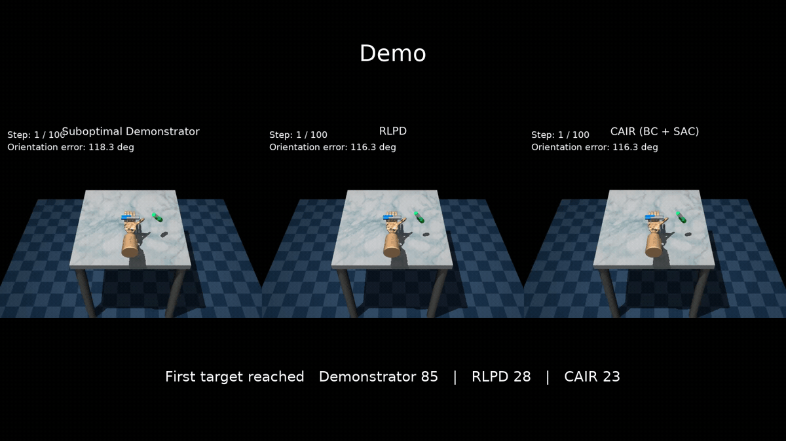

# Conflict-Averse IL-RL (CAIR)

Code for **Conflict-Averse IL-RL: Resolving Gradient Conflicts for Stable Imitation-to-Reinforcement Learning Transfer**.

CAIR is a general method for combining imitation learning (IL) and reinforcement learning (RL) during policy training. The repository contains the CAIR update, experiment configurations, demonstration utilities, and tests used to support the paper.

## Supported combinations

The same CAIR module can be used with:

- Behavioral Cloning (BC) + SAC
- Behavioral Cloning (BC) + DDPG
- Behavioral Cloning (BC) + PPO
- DAgger + SAC
- DAgger + DDPG
- DAgger + PPO

Experiments cover Fetch manipulation, Adroit Hammer/Pen, and Gymnasium MuJoCo locomotion tasks.

## Installation

Create a Python environment and install the package:

```bash
python -m venv .venv
source .venv/bin/activate
pip install --upgrade pip
pip install -e '.[dev]'
```

Optional dependencies for datasets and Stable-Baselines3:

```bash
pip install -e '.[data,sb3]'
```

## Verify the installation

```bash
pytest
python scripts/smoke_test.py
```

## Experiment configuration

The main experiment settings are in:

```text
configs/paper_main.yaml
```

View the resolved configuration for a task and IL/RL pairing with:

```bash
python scripts/show_config.py --task adroit_pen --il bc --rl sac
python scripts/show_config.py --task hopper --il dagger --rl ddpg
python scripts/show_config.py --task fetch_push --il bc --rl ppo
```

Available task keys:

```text
fetch_pick_and_place
fetch_slide
fetch_push
adroit_hammer
adroit_pen
halfcheetah
hopper
walker2d
ant
swimmer
humanoid
```

## Using CAIR in a learner

Create the CAIR controller from the experiment configuration and use `cair_actor_step` for the policy update:

```python
from cair import CAIRController, cair_actor_step
from cair.config import resolve_experiment, cair_config_from_experiment

exp = resolve_experiment("adroit_pen", "bc", "sac")
controller = CAIRController(cair_config_from_experiment(exp), device=device)

_, metrics = cair_actor_step(
    il_loss=il_loss,
    rl_loss=rl_loss,
    parameters=policy_parameters,
    optimizer=policy_optimizer,
    controller=controller,
    episode=current_episode,
)

controller.end_training_call(current_episode)
```

`il_loss` is the BC or DAgger imitation loss and `rl_loss` is the policy loss produced by SAC, DDPG, or PPO. Critic/value updates and environment interaction remain part of the underlying RL learner.

A small standalone example is included:

```bash
python examples/synthetic_demo.py
```

## Demonstration data

### Fetch

Generate the rule-based demonstration trajectories with:

```bash
python scripts/generate_fetch_demos.py --task push --episodes 50
python scripts/generate_fetch_demos.py --task slide --episodes 50
python scripts/generate_fetch_demos.py --task pick_and_place --episodes 50
```

### Locomotion

Download the configured Minari datasets with:

```bash
python scripts/download_minari.py --task all
```

### Adroit

Adroit benchmark data and expert policies are not included in the repository. Place the required resources under `data/adroit/`:

```text
hammer-demos-v0-bc-combined.hdf5
expert.zip
pen-v0_demos.pickle
pen-v0.pickle
```

Check the available resources with:

```bash
python scripts/check_resources.py
```

## Repository structure

```text
configs/            experiment configurations
src/cair/           CAIR implementation
src/cair/demos/     demonstration/data utilities
scripts/            setup and data utilities
examples/           minimal usage example
tests/              unit tests
data/               local benchmark resources (not committed)
```

## Citation

Citation metadata is provided in `CITATION.cff`.

## Qualitative Example

<p align="center">
  
</p>

